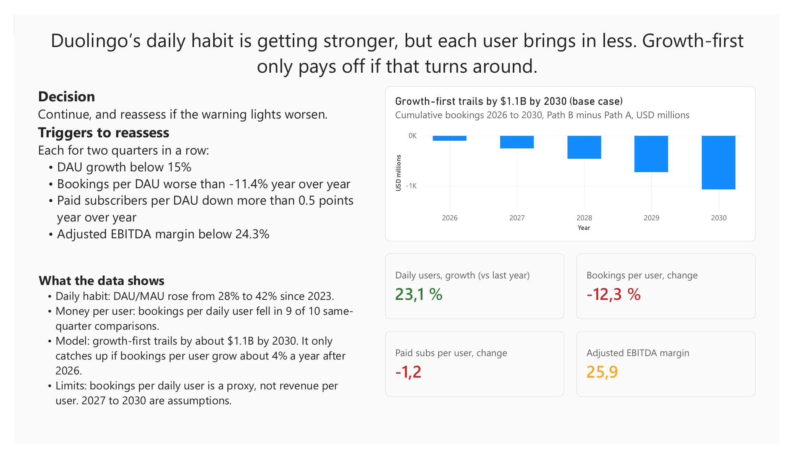

# Is Duolingo's growth-first bet on track?

An independent Power BI analysis of Duolingo's public quarterly data (Q1 2023 to Q2 2026). Not affiliated with Duolingo.

**Question.** Duolingo's daily habit is getting stronger, but bookings per daily user are falling. Is the 2026 decision to put user growth ahead of monetization on track, and what must be true for it to pay off?

**Answer.** Continue, with conditions. On bookings alone, growth-first trails monetization-first by about $1.1 billion by 2030 in the base case. It only catches up if bookings per user grow about 4% a year after 2026. Today they are falling, so the case for the strategy rests on value this data cannot measure.

## What the analysis shows
- **Daily habit is stronger.** DAU/MAU rose from 28% to 42% since 2023.
- **Each user brings in less.** Bookings per daily user fell in 9 of 10 same-quarter year-over-year comparisons. Most of the decline predates the February 2026 strategy shift.
- **Break-even depends on money per user.** In the model, growth-first does not break even by 2030 in the base case. The sensitivity chart shows what yearly change in bookings per user would close the gap.
- **Warning lights (Q2 2026).** Daily-user growth is green. Bookings per user and paid subscribers per user are red. Adjusted EBITDA margin is amber.

## Recommendation
Continue the growth-first strategy and reassess if any of these happens for two quarters in a row:
- DAU growth below 15%
- Bookings per DAU worse than -11.4% year over year
- Paid subscribers per DAU down more than 0.5 points year over year
- Adjusted EBITDA margin below 24.3%

Full text: [RECOMMENDATION.md](RECOMMENDATION.md).

## Pages in the dashboard
| Page | Content |
|---|---|
| Summary | Headline, decision, triggers, gap chart, four scorecard values |
| Dashboard | Engagement vs monetization: DAU/MAU, bookings per daily user, growth rates |
| Break-even model | Path A (monetization first) vs Path B (growth first), gap, sensitivity |
| Scorecard | Four indicators with thresholds and responses |

Screenshots are in [screenshots/](screenshots/).

## Method
- **Data:** 14 quarters from Duolingo's shareholder letters (SEC 8-K exhibits). `verify_dataset.py` recomputes growth rates, DAU/MAU and full-year totals and compares them with figures Duolingo printed. Sources are listed in [SOURCES_AND_DATA_DICTIONARY.md](SOURCES_AND_DATA_DICTIONARY.md).
- **Model:** Bookings = average DAU x bookings per DAU, from a 2025 base (DAU 49.4M, bookings $1,158M, $23.46 per DAU). Both paths are compared on cumulative bookings 2026 to 2030.
- **Scorecard:** Green = on or ahead of management's plan or guidance. Amber = within the typical quarter-to-quarter change of that indicator. Red = beyond it.
- **Claims register:** every figure is labelled reported, calculated or assumed in [claims_and_assumptions_register.csv](claims_and_assumptions_register.csv).

## Assumptions (author's own)
| | Path A: monetization first | Path B: growth first |
|---|---|---|
| 2026 DAU growth | 10% | 20% |
| 2027 to 2030 DAU growth | 8% a year | 12% a year |
| 2026 bookings per DAU | +9.1% | -7.5% |
| 2027 to 2030 bookings per DAU | +4% a year | -2% a year |

**Why these values (in my words):**

These are scenario assumptions, not Duolingo guidance or predictions. The 2026 figures are calibrated to management's statements: about 11% bookings growth with about 20% DAU growth for the growth-first plan, and about 20% bookings growth for the old approach (register items R02 and R05). Management gives no DAU figure for the old approach, so Path A's 10% is my own judgement. Path A assumes a more moderate 10% DAU increase in 2026 and 8% annual growth afterwards because a monetization-first approach prioritizes earning more from the existing user base rather than maximizing acquisition. Its +9.1% bookings-per-DAU change in 2026 represents an illustrative recovery in monetization, followed by +4% annual growth from 2027 to 2030; that recovery is a condition the strategy would need to sustain, not something the historical data proves will happen.

Path B assumes faster user growth: 20% in 2026 and 12% annually from 2027 to 2030, reflecting the potential benefit of keeping the focus on expanding the daily audience. However, the model assigns a short-term monetization cost of -7.5% bookings per DAU in 2026 and a further -2% annual decline afterwards. This is a deliberately cautious trade-off scenario: the dashboard shows that bookings per daily user have already fallen in 9 of 10 same-quarter comparisons, so it would be risky to assume monetization automatically improves as the audience grows. These values let the model test whether stronger user growth can compensate for weaker bookings per user; they should be revised if new results show a different pattern.

## Limitations
- Public company data only; 14 quarters.
- Bookings per DAU is a proxy, not revenue per user.
- 2027 to 2030 values are assumptions. The base case favours Path A by construction, so the model asks what must be true for Path B to catch up.
- No causal claim about the streak: the streak evidence is company-reported and correlational.
- Q2 2026 DAU growth was helped by a one-time Streak Revival event, and Q2 2025 was a tough comparison base for bookings.
- Scorecard thresholds come from only 10 quarters of year-over-year history.

## What I learned
The most interesting finding was that Duolingo's daily engagement improved substantially, with DAU/MAU rising from 28% to about 42%, while bookings per daily user declined in 9 of 10 same-quarter year-over-year comparisons. This shows why user growth alone is not enough to judge whether the growth-first strategy is working. The $1.1 billion gap by 2030 in the base case comes from my assumptions, so the more useful result is the condition it points to: growth-first needs bookings per user to grow about 4% a year after 2026 to catch up. Next, I would monitor the next few quarters to see whether bookings per DAU and paid subscribers per DAU stabilize as the larger user base develops, while also checking whether the Q2 2026 growth boost persists beyond the one-time Streak Revival event. The model is useful for comparing scenarios, but it cannot prove that the strategy caused the observed changes or measure longer-term benefits such as retention and future customer value; its 2027–2030 results depend on assumptions rather than observed data.

## Files
| File | Purpose |
|---|---|
| duolingo_streak_analysis.pbix | Power BI file |
| duolingo_quarterly_kpis.csv | Quarterly KPI data |
| duolingo_context_events.csv | Dated company events |
| verify_dataset.py | Data checks against figures Duolingo printed |
| claims_and_assumptions_register.csv | Reported vs calculated vs assumed |
| RECOMMENDATION.md | Written recommendation |
| SOURCES_AND_DATA_DICTIONARY.md | Sources and column definitions |

## Author
Tasneem Syed, M.Sc. AI for Business, SRH Berlin.
